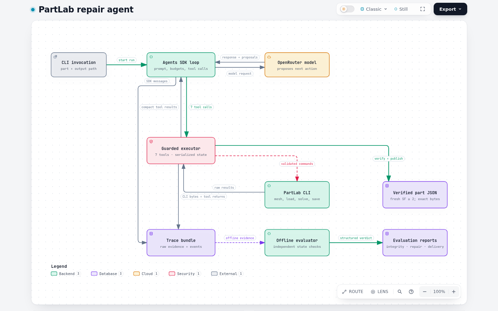
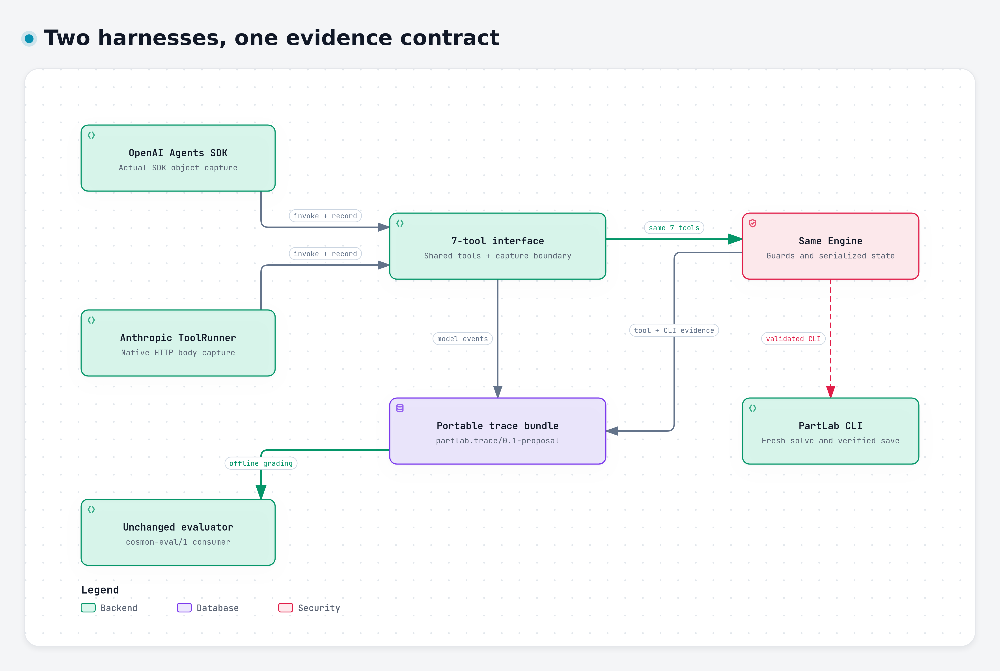

# PartLab repair agent

An agent that measures a part's safety factor under its default load, searches
for a legal single-parameter repair, verifies it with PartLab, and saves it.
The model proposes changes; Python enforces the workflow and constraints;
an independent offline evaluator checks the recorded evidence.

Start with the [reviewer walkthrough](docs/REVIEWER_GUIDE.md) for a reading order,
the important files, and a step-by-step path from a result to its evidence.



## Results

Live runs used **OpenRouter / `openai/gpt-6.1-sol`, medium reasoning**.

| Part | Baseline SF | Outcome |
| --- | --- | --- |
| `bracket_v3` | 1.428 | Thickness 3 → 5 mm; fresh SF **3.072**; [verified saved part](outputs/bracket_v3.json) |
| `flange_v1` | 0.212 | Six legal trials; best SF **0.839**; no repair found within the configured search |

The flange result is bounded search exhaustion, not proof of infeasibility.
No unsafe flange artifact was saved. See the [submission report](REPORT.md)
for evidence, acceptance criteria and limitations.

The [five-model benchmark](reports/model-benchmark-20261024/INDEX.md) contains
all ten runs, raw traces and independent reports. All five models repaired the
bracket; three returned valid bounded flange reports and two failed the final
JSON format. Read the [findings](reports/model-benchmark-20261024/FINDINGS.md)
for cost, speed and interpretation limits.

## One trace contract, two harnesses



OpenAI Agents SDK and Anthropic Python SDK ToolRunner both execute the same
guarded PartLab workflow and emit the same trace contract. Two additional live
Anthropic runs were evaluated without changing the grading engine.
[Portability evidence and design decisions](docs/HARNESS_PORTABILITY.md)
explain the native-message mapping, checks and remaining limits.

## Run

Requires Python 3.12 and the supplied Linux AMD64 `partlab` executable.

```sh
python3.12 -m venv .venv
.venv/bin/python -m pip install -r requirements.lock
test -f .env || cp .env.example .env
chmod 600 .env
```

Set `OPENROUTER_API_KEY` in the ignored `.env`, then run:

```sh
.venv/bin/python -m cosmon_agent --part bracket_v3 --output runs/bracket-001
.venv/bin/python -m cosmon_agent --part flange_v1 --output runs/flange-001
.venv/bin/python -m unittest discover -s tests -v
```

Each run uses a new private PartLab session and records its reset. Use a new
trace directory for each run. A different existing output is never overwritten;
use `--publish-dir runs/replay-001/outputs` to isolate replay artifacts.

[RUN.md](RUN.md) contains the complete agent, negative-check and evaluation
commands. Evaluation and offline tests require no API key.

## Evaluation and reproducible checks

The [evaluator](evaluation/README.md), [five-requirement rubric](evaluation/docs/EVAL_RUBRIC.md),
raw examples and detailed scoring decisions are included in this repository.
The combined checkout passes **22 agent tests and 156 evaluator tests**; the
156 evaluator tests and all 19 expected report cases also pass in Docker with
networking disabled. See the [consolidated verification](reports/main-integration-20261024/README.md).

[Scout](evaluation/scout_setup/README.md) displays the evaluator’s findings;
[Harbor](evaluation/docs/HARBOR_SETUP.md) checks the separate Docker execution
and verification environments. Both are optional and have pinned dependencies.
The Dockerfiles and task source are tracked; local images and environments are not.

## Design

- **Seven tools:** open, inspect parameters, set one parameter, mesh, apply the
  exact default load, solve, and save. One serialized executor enforces their
  preconditions and captures every CLI command.
- **Independent trials:** restore the original before each candidate; stop at
  the first fresh, converged solve with SF ≥ 2. Manufacturing limits remain
  mandatory even when exploration ranges change.
- **Compact observations:** model-facing solve results were 334–379 bytes;
  full solver logs remain in the raw trace bundle. The agent does not fetch
  safety factor, stress or logs again after a solve.
- **Inspectable evidence:** actual SDK messages, raw arguments, exact tool
  returns, CLI stdout/stderr, and saved bytes are retained. The evaluator
  reconstructs state independently of the agent's success claim.

[Decision record: choices, reasons and tradeoffs](DECISIONS.md) ·
[Architecture and workflow](docs/ARCHITECTURE.md) ·
[Original assignment, unchanged](TASK.md) ·
[Trace format](evaluation/docs/EVAL_IMPLEMENTATION_CONTRACT.md)

The human recording link is the remaining submission item. This repository
contains the implementation and evidence; it does not claim a recorded
one-hour session.
