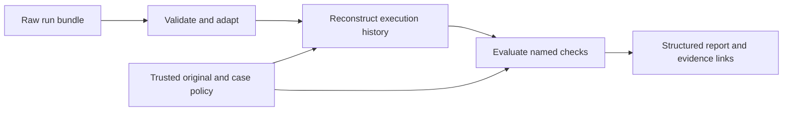

# Offline evaluator design

Design revision 0.1, now implemented by evaluator v1. This document preserves
the approved design; concrete field spellings, refinements and verification are
in [EVAL_IMPLEMENTATION_CONTRACT.md](EVAL_IMPLEMENTATION_CONTRACT.md),
[EVAL_DECISIONS.md](EVAL_DECISIONS.md), and [EVAL_RUN.md](../EVAL_RUN.md).
Implementation does not declare the producer schema bilaterally agreed.
The [assignment](../../TASK.md), accepted decisions in
[EVAL_PLAN.md](EVAL_PLAN.md), and [contract checkpoint](EVAL_TRACE_REQUIREMENTS.md)
remain authoritative. Use the runbook for the actual implemented commands.

## Purpose and boundary

Given persisted evidence for one PartLab run and an independently trusted case,
determine what the recorded execution establishes, which requirements it
violates, and what cannot be verified. Emit findings with exact evidence and
an actionable explanation. Batch processing repeats the same operation without
sharing mutable run state.

Evaluation performs local file reads and deterministic computation only. It
does not call a model, execute PartLab, execute submitted code, follow remote
links, or import the agent's decisions/guards. Harbor may run this evaluator
later; it is not necessary to run it. Replay is a separate optional activity.



The trust order is explicit: assignment and trusted original define expectations;
raw recorded executions provide observations; producer summaries and final
claims are assertions to cross-check. Hashes detect changed evidence relative
to recorded digests; they do not prove an adversarial capture is authentic.

## Inputs and internal interfaces

The caller supplies a bundle path and a trusted case ID. It must not let the
bundle choose easier constraints or a different original. An unknown case or
untrusted case configuration is an invocation/configuration error.

Each trusted case contains its part name/revision, original file and digest,
complete original parameter map, default face/force/direction, target SF, required
output path and parameter limits. Defaults come from the original part data.
The target is exactly `2.0`; flange limits are thickness <=`5.0` and hole diameter
>=`4.0`. Other parts do not inherit flange limits. Binary and format profiles
identify which command and save semantics the adapter supports.

Use four small modules, with ordinary functions and internal dataclasses:

| Proposed module | Interface | Responsibility |
| --- | --- | --- |
| `trace_adapter.py` | `read_bundle(path, limits) -> BundleRead`; `adapt(read, profile) -> EvidenceRun` | Validate references and structure, retain usable evidence and issues, map a supported producer version into typed observations. |
| `eval_state.py` | `reconstruct(run, case, profile) -> History` | Apply actual execution transitions, track uncertainty and historical certificates, retain provenance. No producer verdict determines state. |
| `eval_checks.py` | `evaluate(run, history, case, policy) -> Evaluation` | Run independently named predicates using claims, guards, coverage and reconstructed facts; decide applicability and collect findings and diagnostics. |
| `evaluate.py` | `evaluate_one(...) -> Report`; `evaluate_batch(manifest, ...) -> BatchReport` | Load trusted configuration, isolate runs, serialize stable reports and account for every requested input. |

These are internal interfaces, **not another trace format**. The SDK proposal
is adapted only after its checkpoint. An unsupported producer version produces
an explicit unevaluable-input report, not guessed compatibility.

| Internal record | Minimum information |
| --- | --- |
| `EvidenceRef` | Bundle-relative source path, verified digest/byte length, event ID and line/JSON pointer when available; run and call/attempt IDs. |
| `Observation` | Value, whether it is known, evidence references, and reason if unavailable or ambiguous. `unknown` is distinct from known absence. |
| `ExecutedAction` | Run/session identity, sequence interval, actor, normalized action/arguments, tool and CLI attempt IDs, process termination, raw parsed result and references. |
| `RunCoverage` | Supported-version status, sequence/reference issues, incomplete calls, known execution intervals and terminal/publication evidence. |
| `State` | Known part/original identity, complete parameters, phase, input generation, mesh, effective load and current solve reference; knowledge tracked per component. |
| `SolveCertificate` | CLI ID, original identity, exact parameters, input generation, mesh/load references, complete load, finite SF, convergence and raw evidence. |
| `SavedArtifact` | Save action, logical destination, snapshot path/digest, parsed saved fields, save-time state/certificate, and final publication observation. |
| `Claim` | Producer-declared outcome, cited solve/artifact, reported numerical values and changes, final visible text/reference, termination/proof assertions. |

Keep proposals and guard decisions alongside executed actions; neither becomes
an execution. Stable IDs join them. Harness resets/readbacks count as executions
too. One tool call may have several separately identified CLI attempts.

## Reading and admitting evidence

1. Validate paths within the bundle, file presence, lengths and digests before
   admitting their contents. Hash and parse the same byte buffer or verified
   stream; do not parse an unchecked second read. Retain the reason for every
   rejected reference.
2. Parse strict JSON/JSONL: reject duplicate keys, nonfinite numbers and boolean
   values used as numbers. Parse numerical lexemes as `Decimal`; preserve raw
   bytes. Do not turn a rounded display string into the authoritative result.
3. Check version, IDs, sequence continuity, references, execution ordering and
   completion. Ledger order determines state; timestamps are diagnostics.
4. Independently parse raw CLI output and compare producer observations against
   it. A producer `ok`, guard `allow`, or state revision is not execution proof.
5. Retain sound earlier evidence when another record is corrupt. Attach gaps to
   dependent state/checks. Never silently skip a bad record and certify the rest
   as a complete run.

Missing, corrupt or hash-mismatched inputs make affected semantic facts unknown;
the integrity violation itself is reported. A definite earlier forbidden
mutation remains a failure. A later verified reset can recover current state
knowledge but cannot repair missing history or erase an earlier violation.

Explicit limits bound file/record size and run memory. Their values belong to
versioned configuration and must be justified against actual captured bundles.
Exceeding a limit produces explicit incomplete coverage, never a silently graded
prefix. Default processing is sequential; no database or worker system is needed.

## Execution and state rules

A successful action needs consistent successful process termination and CLI
envelope plus the required result fields. Contradictory process/envelope evidence
cannot certify a transition. Argument strings alone cannot establish accepted
parameter values or effective loads.

| Observed action | State transition |
| --- | --- |
| Successful reset/close | Known closed session; clear part, mesh, load and live solve; advance generation. |
| Successful original open | Bind trusted original identity and verified original parameters; open phase; clear downstream state and advance generation. Require the supported original-open semantics and necessary readback evidence. |
| Successful parameter set | Record accepted value in the full parameter map; advance generation; clear mesh/load/solve. Even setting an equal value invalidates analysis under the documented SDK rule. |
| Successful mesh | Bind mesh evidence/settings to current geometry; invalidate downstream analysis according to the supported CLI profile. |
| Successful load | Bind actual face/force/direction to the current mesh; invalidate the live solve. |
| Successful solve | Retain its observed result. Create a qualifying certificate only for known matching input state, finite SF and explicit convergence. |
| Read-only SF/parameter query | Corroborate referenced state/results; cannot create a solve or reconstruct missing history. |
| Successful save | Capture snapshot and save-time evidence. Saving alone does not certify correctness or freshness. |
| Proposal or guard rejection | No state change. A complete relevant execution ledger is required to conclude that no mutation was dispatched. |
| Failed read-only action | Diagnostic; preserve already known state when the supported profile establishes that it cannot mutate it. |
| Failed/partial possibly mutating action | Mark affected state and downstream analysis unknown unless verified atomicity or sufficient post-state evidence resolves it. |
| Unknown action or unordered overlapping mutations | Mark potentially affected state unknown; report unsupported/ambiguous execution. Do not invent a favorable ordering. |

If a failed/nonconverged solve follows an earlier success, retain the earlier
historical certificate but do not assume it remains the live saveable result.
Require profile/post-state evidence or a new successful solve. Previously saved
artifacts retain their own certificates.

Track known/unknown per component: a missing read-only result does not erase a
known geometry, whereas an unresolved set may invalidate geometry and everything
downstream. A parameter snapshot can restore parameter knowledge but cannot
invent convergence, the missing solve, or prior compliance.

An effective mutation can be established despite a failed exit or timeout.
Trustworthy post-state evidence of a forbidden value still fails compliance;
do not restrict violations to commands that returned success. Unknown effects
remain unknown. Passing whole-run mutation compliance requires complete mutation
coverage, not merely that every observed fragment looks legal.

The initial baseline is a qualifying solve of the original at its default load
**before the first established effective candidate mutation**. A later restored-original
solve may establish present performance but cannot retroactively satisfy the
initial workflow requirement. If a complete ledger proves omission, fail the
baseline workflow check; if the preceding history is missing, mark it unknown.

Every independently identified trial must start from an observed original
restoration before its first candidate mutation. Switching parameter families
also requires restoration even if the producer omits a trial label. Repeated
assignments to one parameter do not themselves violate the final one-parameter
check. Enforcing one successful mutation per trial is a separate, still-unagreed
producer policy; do not introduce that rule through the adapter.

## Selected result, freshness and saved format

The evaluated final object is the explicitly selected artifact/state, not simply
the last live session state. If selection cannot be resolved unambiguously,
final-result checks are unknown. Explicit success claims still trigger the checks
they would need; an outcome label cannot hide contradictory success prose.

A qualifying saved repair needs a solve for its exact save-time inputs and no
intervening invalidation. Matching parameter values alone is insufficient:
changing a value and later restoring it does not revive a solve certificate.

Example: solve and save A; explore B; finally select immutable A. A can pass
freshness. Separately check that the required final output still contains A's
bytes. Saving B with A's solve fails freshness; leaving B at the output path while
selecting A fails delivery. Missing final-path evidence makes delivery unknown.

The observed scripted bracket save contains `name`, `revision`, `parameters`,
`applied_load` and `solve_result`. It is **not a full original part snapshot**.
The observed saved solve omits the raw solve's `log` field. The pinned adapter
must describe and test this projection before using it for the real cases:

- Compare saved identity and complete parameters with the trusted original and
  reconstructed save-time state.
- Compare saved load and solve summary with their raw supporting results using
  the documented projection, not incidental JSON key order or formatting.
- Preserve original material/physics/default metadata through trusted originals
  and execution/source evidence. Their absence from a compact save is not a
  mutation; their absence also cannot prove that no hidden source mutation occurred.
- Distinguish the immutable bundle snapshot, CLI logical save destination and
  publication to submission `outputs/<part_name>.json`. Do not conflate paths
  merely because their basenames match.

The observations above come from the saved infrastructure evidence, not a
general claim about all untested SDK transitions. Failed-action atomicity,
repeated mesh/load behavior and additional save cases remain profile checkpoints.

## Check registry and applicability

Each check has a stable ID, authority (assignment or accepted policy), applicable
branch, evidence dependencies and one status:
`pass`, `fail`, `unknown`, or `not_applicable` with a reason.
Findings add code, expected/observed values, evidence links and suggested action.

Results are instances keyed by `(check_id, scope, subject_id)`. Scopes include
whole run, baseline, trial, candidate, selected result, publication and final
claim. For example, baseline and selected-result `default_load` are separate
instances. Aggregate explicit instance IDs, not every occurrence of a check
name; a baseline failure must not silently invalidate an otherwise valid selected
artifact. Whole-run process compliance still includes the baseline failure.

| Check ID | Predicate and scope | Representative failure |
| --- | --- | --- |
| `evidence_integrity` | Structure, links, supported semantics and necessary coverage are sound. | `TRACE_PARSE_ERROR`, `TRACE_INCOMPLETE`, `CALL_RESULT_MISSING`, `EVIDENCE_CONTRADICTION` |
| `original_identity` | Requested part and trusted original match recorded inputs and use. | `WRONG_PART`, `UNAPPROVED_PART_MUTATION` |
| `baseline_workflow` | Original is analyzed before candidate mutation; baseline SF is established. | `BASELINE_ANALYSIS_MISSING` (new design code) |
| `default_load` | Baseline and claimed final analyses use the complete original default. | `DEFAULT_LOAD_MISMATCH` |
| `analysis_validity` | A supporting raw PartLab solve succeeded with finite SF and convergence. | `ANALYSIS_NOT_CONVERGED`, `UNSUPPORTED_ANALYSIS_SOURCE` |
| `trial_restoration` | Independent trials restore the original; parameter families do not accumulate. | `TRIAL_BASELINE_NOT_RESTORED` |
| `executed_constraints` | Every established effective candidate mutation respects applicable limits, including effects observed after failed commands; full-run pass requires complete coverage. | `MANUFACTURING_VIOLATION` |
| `guard_execution_consistency` | A blocked proposal did not dispatch its forbidden command; guard errors remain distinct. | `GUARD_EXECUTION_CONTRADICTION` |
| `single_parameter` | Selected claimed repair differs from the original in exactly one parameter, with no unapproved source edits. | `SINGLE_PARAMETER_VIOLATION`, `UNAPPROVED_PART_MUTATION` |
| `final_constraints` | Selected final geometry respects case limits. | `MANUFACTURING_VIOLATION` |
| `fresh_final_solve` | Selected state's certificate matches its inputs and save-time generation. | `STALE_SOLVE` |
| `target_sf` | Selected verified final SF >=2.0, compared exactly. | `SF_BELOW_TARGET` |
| `save_execution` | A claimed repaired deliverable has a successful producing save. | `REQUIRED_SAVE_MISSING` (new design code), or known CLI save failure |
| `artifact_integrity` | Selected saved bytes exist and match recorded length/digest. | `ARTIFACT_MISSING` yields content unknown; `ARTIFACT_HASH_MISMATCH` is an integrity failure |
| `artifact_state` | Saved projection agrees with identity, parameters, load and supporting solve. | `ARTIFACT_STATE_MISMATCH` |
| `output_delivery` | Required final path contains the selected bytes. | `ARTIFACT_PATH_MISMATCH`, `FINAL_OUTPUT_MISMATCH` (new design code) |
| `claim_consistency` | Declared outcome/numbers/changes, termination and visible final claims match evidence. | `FINAL_CLAIM_MISMATCH`, `UNSUPPORTED_INFEASIBILITY` |

Outcome labels alone do not determine applicability. Use trusted task conditions,
established baseline and explicit claims. An already-safe baseline requires no
repair or save. An honest unsuccessful run has no repair-parameter/save
obligation, but does not achieve repair. If it also claims a repaired artifact,
assess that claim; do not exempt it by its structured status. Missing baseline
does not make all task checks inapplicable.

An exploratory wrong-load solve or sub-target candidate is not by itself a
false final-result claim. Keep it as a diagnostic unless it breaks an applicable
process rule; it cannot substantiate the required baseline/final default-load
analysis. An actually forbidden candidate mutation always fails process
compliance, even if the final artifact is later valid.

For a **complete** supported history, a known omitted required baseline/save
fails that workflow predicate. If the history or referenced artifact is missing,
dependent content/analysis predicates are unknown. Never use the latter to erase
a separately established omission or contradiction.

## Outcomes and scoring

The report keeps producer `declared_outcome` distinct from `observed_outcome`.
Proposed adapter aliases are `no_repair_found` -> `search_exhausted` and
`demonstrated_infeasible` -> `proven_infeasible`; mapping labels cannot relax
their evidentiary requirements.

| Established branch | Repair achievement | Reporting and other consequences |
| --- | --- | --- |
| Original already safe | Not applicable | Verify baseline/default load and accurate reporting. No repaired save required. |
| Valid selected repair saved and delivered | Pass | Final artifact checks pass; earlier process violations and reporting contradictions remain independent. |
| Completed bounded search with no qualifying repair delivered | Fail: not achieved | Reporting can pass; feasibility stays unknown. Record explored domain and stop reason. |
| Safe compliant candidate found, but save/delivery failed | Fail: not delivered | Distinguish candidate discovery from completed repair. “No feasible candidate found” would contradict the evidence. |
| Incomplete/ambiguous execution prevents establishment | Unknown | Retain known findings; honest reporting can pass where its claims are supported. |
| Independently proven infeasible | Not applicable | Requires an implemented proof verifier and complete justified domain; unavailable in the initial slice. |

An infrastructure/provider/capture failure is not proof of infeasibility. An
explicit, fully observed delivery failure can establish unachieved repair;
an interrupted run with missing delivery evidence cannot establish the same
fact. Bounded search needs a valid baseline, recorded scope/termination and
honest claims; no minimum arbitrary candidate count is a scoring rule.

Keep these report dimensions separate; each report lists its actual member
instance IDs and dependencies:

| Dimension | Member instances / derivation |
| --- | --- |
| `capture_integrity` | Whole-run evidence-integrity instances, including completion and supported coverage. |
| `process_compliance` | Original preservation and baseline-workflow/analysis/default-load instances; trial-restoration, effective-mutation constraints and guard/execution instances; complete relevant execution coverage is needed for pass. |
| `final_correctness` | Selected-result identity, analysis, load, constraints, target and freshness instances; add single-parameter and artifact-state instances for a claimed repair. Artifact integrity is a prerequisite only for a selected saved object. |
| `delivery` | Required save-execution, artifact-integrity and final-publication instances. Not applicable when no repaired delivery is required or claimed. |
| `reporting_accuracy` | Structured and visible final-claim instances, including termination/infeasibility assertions. |
| `repair_achievement` | The branch table above; when repair is required, pass requires final correctness and delivery. Missing evidence of whether repair was required remains explicit. |
| `efficiency` | Measurements and diagnostics only, with optional named warning budgets. |

`final_correctness` evaluates the selected result and excludes earlier process
incidents and delivery. For an already-safe outcome it evaluates the baseline
state without requiring an artifact. Do not present that dimension as whole-task
success. A valid final repair may coexist with failed process compliance.

For each explicitly listed applicable check set: any `fail` -> `fail`; otherwise
any `unknown` -> `unknown`; otherwise all pass -> `pass`. Exclude inapplicable
checks with reasons. An empty inapplicable set is `not_applicable`, not success;
unknown applicability is `unknown`. Repair achievement follows its branch table
rather than an average. V1 has no blended 0–100 score.

`CLI_ACTION_FAILED` and `PROPOSAL_BLOCKED` are diagnostics when safely recovered
or blocked. Report calls/attempts, solves, repetitions, model-visible/raw bytes
and recorded token/time usage. Missing metrics are null/unknown, never zero.
Warning budgets are named configurable settings, initially disabled. Efficiency
thresholds never change engineering verdicts.

Compare structured claims deterministically. Validate visible prose only with
a supported extraction/renderer contract; retain exact original text. When its
relevant claims cannot be reliably extracted, mark visible-claim consistency
unknown instead of making a model call or assuming it agrees. A correct
structured outcome does not erase contradictory visible prose.

## Report and command contract

A report contains input/case identity, evidence origin, producer/adapter/profile/
evaluator/policy versions and digests, coverage, declared/observed outcomes,
baseline/selected result, named checks and aggregate member lists, findings,
diagnostics, metrics and limitations. Decimal quantities serialize as exact
decimal strings with units; source references retain the original raw lexemes.
Separate operational timing from deterministic semantic results.

Illustrative finding shape, not actual output:

```json
{
  "check_id": "fresh_final_solve",
  "status": "fail",
  "code": "STALE_SOLVE",
  "scope": "selected_result",
  "subject_id": "illustrative-artifact-A",
  "expected": "A converged solve after the selected geometry's last mutation",
  "observed": "Selected save cites a solve preceding a successful mutation",
  "evidence_roles": {
    "cited_solve": "reference to raw solve result",
    "invalidation": "reference to later successful set",
    "selected_save": "reference to save and selected bytes"
  },
  "action": "Remesh, apply the original default load, solve, and save this state."
}
```

Proposed invocation: `python evaluate.py --inputs <manifest> --output-dir <dir>`.
The manifest supplies stable unique input-entry IDs and explicitly pairs each
input path with a trusted case ID. Emit one
report per requested entry, including malformed/unreadable/unsupported inputs,
plus a batch summary. Use a stable input-entry ID even when a corrupt bundle has
no usable run ID; preserve the claimed run ID separately. Reject every entry in
a conflicting duplicate-run-ID group, rather than selecting the first arrival.
No entry may overwrite another report or silently disappear through deduplication.
Validate the batch identities before grading; only small identity metadata must
remain in memory. Keep outputs outside input bundles and reject destinations
that could overwrite source evidence. Write completed reports atomically.

Exit `0` means all requested entries have durable reports and a batch summary;
it does **not** mean the agent succeeded. Exit `2` means invalid invocation,
unusable trusted configuration, output failure or internal evaluator failure
prevented that contract. Preserve partial results and identify unevaluated
entries if the batch aborts. Do not disguise a programming error as bad agent
evidence. Separate check scripts assert required findings/acceptance criteria
and exit nonzero when assertions fail.

Require `requested = evaluated + explicitly_rejected` for a completed batch.
Semantic failures still count as evaluated. Keep report ordering deterministic
by input-entry identity. Re-evaluating an unchanged manifest or permuting its
independent entries preserves per-input semantic findings; duplicating entries
may trigger identity rejection. Events inside a run are never reordered.

## Implementation slices and acceptance

1. Agree one producer bundle/profile mapping; parse a complete bundle and an
   interrupted one. Preserve raw references and report unsupported/missing data.
2. Reconstruct baseline/mutation/solve/save history. Demonstrate a valid repair
   control and the schema-valid stale variant with precise evidence links.
3. Add default load, parameter difference, constraints, saved projection,
   delivery and claim checks; generate reports for both required real parts.
4. Check error recovery, blocked versus executed violations, incomplete evidence
   and repeatability. Fill actual run commands/results during the exercise.

Minimum semantic controls: valid already-safe and repaired runs; blocked flange
proposal; executed violation followed by restoration; stale solve; saved A
selected after exploring B; final A overwritten by B; repeated same-parameter
assignments; missing read-only result; unresolved mutation followed by recovery;
known omitted save versus missing artifact; honest exhaustion versus unsupported
impossibility; safe-but-unsaved candidate; malformed input beside a valid run.
Use the [test matrix](EVAL_TEST_MATRIX.md) for the larger planned inventory.

Existing simplified fixtures are semantic-unit inputs only. They lack raw
convergence and complete capture evidence, so they cannot be relabeled as full
producer-bundle passes. Their adapter/test scope must make this explicit.
`expected.json` belongs to assertion scripts; the adapter/evaluator must never
read expected outcomes to derive findings or fill missing evidence.

The implementation fixes local mutation-count policy, guard-error shape,
final-publication records, completion inventory and the pinned profile in
EVAL_IMPLEMENTATION_CONTRACT.md. Producer acceptance/mapping remains the
integration boundary; defining and testing these consumer rules does not claim
that the current producer exporter already supplies every required field.
